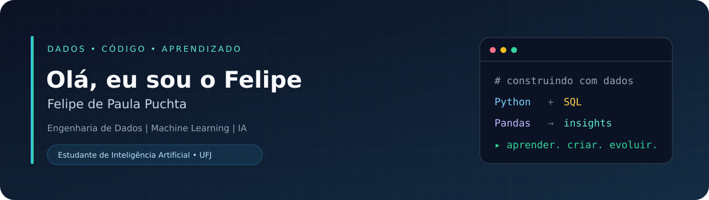

  

   
   

  
  

## 👨‍💻 Sobre mim

Sou **Felipe de Paula Puchta**, graduando em **Inteligência Artificial pela Universidade Federal de Jataí (UFJ)**, com conclusão prevista para dezembro de 2029.

Tenho interesse em transformar dados em informações que apoiem decisões. Estou construindo minha base em **engenharia e ciência de dados**, conectando programação, organização de dados e fundamentos de aprendizado de máquina.

- 🎓 Estudo Inteligência Artificial e fundamentos de Machine Learning.
- 🛠️ Busco aprimorar minhas habilidades no tratamento, na análise e na organização de dados.
- 🌱 Meu foco de aprendizado reúne **Python, SQL e Pandas**.

## 🧰 Minha stack de estudos

  <table>
    <tr>
      <td align="center" width="160"> <strong>Python</strong></td>
      <td align="center" width="160"> <strong>SQL</strong></td>
      <td align="center" width="160"> <strong>Pandas</strong></td>
    </tr>
  </table>

| Tecnologia | Como se conecta ao meu aprendizado |
| :--- | :--- |
| **Python** | Programação para trabalhar com dados, automatizar tarefas e explorar fundamentos de Machine Learning. |
| **SQL** | Consultas, filtros, agregações e relacionamentos para organizar e explorar dados em bancos relacionais. |
| **Pandas** | Leitura, limpeza, transformação e análise de dados em DataFrames, preparando informações para novas análises. |

## 🐍 Minhas contribuições

Cada contribuição faz parte do aprendizado.

<picture>
  <source media="(prefers-color-scheme: dark)" srcset="https://raw.githubusercontent.com/FelipePuchta/FelipePuchta/output/github-contribution-grid-snake-dark.svg" />
  <source media="(prefers-color-scheme: light)" srcset="https://raw.githubusercontent.com/FelipePuchta/FelipePuchta/output/github-contribution-grid-snake.svg" />
  
</picture>

<!-- Ícones de Python e Pandas: https://github.com/devicons/devicon (MIT). -->
